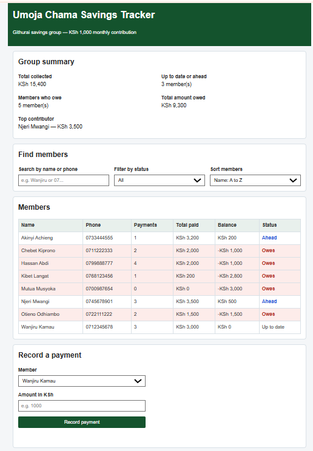

# Umoja Chama Savings Tracker

This is a simple web page for the treasurer of Umoja Chama, a savings group with eight members in Githurai.

Each member is expected to contribute KSh 1,000 every month. The page helps the treasurer see who has paid, who owes money, and who has paid ahead.

## How to use the page

1. Open `index.html` in a web browser.
2. Type a member’s name or phone number in the search box.
3. Choose a status in the filter dropdown to see members who owe, are up to date, or are ahead.
4. Choose how to arrange the table using the sort dropdown.
5. Choose a member, enter an amount, and click **Record payment** to save a contribution.

## What the page shows

- Each member’s name, phone number, number of payments, total paid, balance, and status.
- Members who owe are clearly marked with the word **Owes** and a light red background.
- The summary shows the total collected, members who are up to date or ahead, members who owe, total amount owed, and the member who has paid the most.
- The page shows **No members match** when search and filter do not find anyone.

## How the code works

- `members` is an array that stores all eight members and their payments.
- `totalPaid(member)` uses `reduce` to add all payments for one member.
- `balance(member)` calculates the amount paid minus the expected amount.
- `status(member)` returns `Owes`, `Up to date`, or `Ahead`.
- `groupTotal(list)` uses `reduce` to calculate the total paid by all members.
- `renderMembers()` clears the table and creates new rows using `createElement` and `textContent`.
- `renderSummary()` calculates the summary figures from the member data.
- `renderMemberOptions()` fills the payment dropdown with member names.
- `handlePayment()` checks the amount, adds the payment, clears the input, and updates the page.

## Console tests

Open browser DevTools and run these tests:

```js
totalPaid(members); // 0 — Mutua has no payments[1]
balance(members); // -3000 — Mutua owes KSh 3,000[1]
status(members); // "Owes"[1]

totalPaid(members); // 3200 — Akinyi has paid KSh 3,200
balance(members); // 200 — Akinyi is ahead by KSh 200
status(members); // "Ahead"

totalPaid(members); // 3000 — Wanjiru is up to date
balance(members); // 0
status(members); // "Up to date"

groupTotal(members); // 15400 — total collected before new payments
```

## Expected starter figures

Before recording any new payment:

- Total collected: KSh 15,400
- Wanjiru Kamau: up to date
- Akinyi Otieno: ahead by KSh 200
- Njeri Mwangi: ahead by KSh 500
- Otieno Ochieng: owes KSh 1,500
- Mutua Kilonzo: owes KSh 3,000
- Five members owe a total of KSh 9,300
- Top contributor: Njeri Mwangi, KSh 3,500

## Screenshot

Add a screenshot of your working page here after you open it in the browser.


